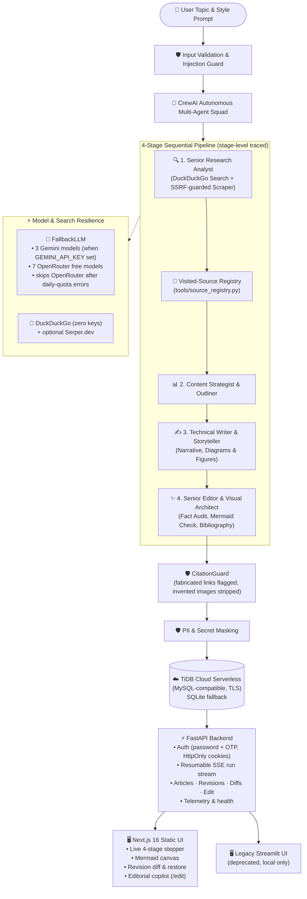

# 🤖 Enterprise Multi-Agent AI Research & Visual Blog Studio

> **Autonomous multi-agent research squad that conducts deep research and writes publication-ready technical blog posts with native Mermaid architecture diagrams and verified citations — powered by CrewAI, a free multi-model fallback chain (OpenRouter + Google Gemini), FastAPI, Next.js 16, and TiDB Cloud Serverless.**

[](https://python.org)
[](https://crewai.com)
[](https://openrouter.ai)
[](https://ai.google.dev)
[](https://tidbcloud.com)
[](https://fastapi.tiangolo.com)
[](https://nextjs.org)
[](https://smith.langchain.com)
[](https://owasp.org/www-project-top-10-for-large-language-model-applications/)
[](https://pytest.org)
[](LICENSE)

---

## ✨ What It Does

Give the squad a topic — it runs a four-stage agent pipeline that researches the web, outlines, writes, and audits a long-form technical blog post with a Mermaid architecture diagram, inline citations, and revision history.

Unlike typical shallow AI generators, this system:

1. **Drills into technical detail**: low-level trade-offs, protocol behaviour, benchmarks, and production failure modes, using live search + scraping.
2. **Generates native visuals**: embeds **Mermaid.js** diagrams directly in the Markdown. Model-invented image links are stripped by the citation guard ("diagrams only" policy).
3. **Verifies citations**: search/scrape tools record every URL they actually visited; the final report is audited so unvisited links are flagged and fabricated figures are removed.
4. **Survives rate limits**: transparently fails over across **7 free OpenRouter models + 3 Gemini models** when a provider returns `429`, times out, or is unavailable.
5. **Persists state**: articles, revisions, chat sessions, user style memory, research cache, and run/job events are stored in **TiDB Cloud Serverless** (MySQL-compatible) with automatic local **SQLite** fallback.
6. **Exposes a real editorial copilot**: the Next.js copilot drawer sends instructions to `POST /api/v1/articles/{article_id}/edit`, which creates a genuine revision — there is no client-side simulated reply.
7. **Keeps runs durable**: research jobs are background jobs with a sequenced event log; the SSE stream is resumable via `Last-Event-ID`/`after_seq`, and the UI persists the active run id so a page refresh reattaches instead of dead-ending.

---

## 🏗️ System Architecture & Workflow



---

## 🎯 Key Capabilities

### 1. 🔍 Deep Research with Low-Level Mechanics
- Investigates primary docs, engineering blogs, and benchmarks via live search.
- Captures concrete metrics and design trade-offs; records every visited URL for citation verification.
- Scrapes are SSRF-guarded (blocks loopback/internal ranges and cloud metadata IPs) and size-capped.

### 2. 📊 Native Mermaid.js Diagrams
- Produces `flowchart`, `sequenceDiagram`, and `stateDiagram-v2` blocks embedded in Markdown.
- The UI renders them with a hardened Mermaid setup (`securityLevel: "strict"`, latest render wins).
- Hallucinated `` images are stripped by `CitationGuard` before persistence.

### 3. 🔄 Multi-Model Auto-Fallback
Fallback order depends on configured keys (Gemini is tried first when available, then OpenRouter):

| Provider | Models |
|---|---|
| Google Gemini | `gemini-3.5-flash`, `gemini-3.5-flash-lite`, `gemini-3.8-flash` |
| OpenRouter (free) | `nvidia/nemotron-3.5-lightning:free`, `nvidia/nemotron-3-ultra-550b-a55b:free`, `nvidia/nemotron-3.5-super-vl:free`, `dots-studio/dots-3-note-preview:free`, `cohere/north-mini-code:free`, `nvidia/nemotron-3-nano-omni-30b-a3b-reasoning:free`, `google/gemma-4-31b-it:free` |

- Fails over on `429`, timeout, or provider outage without surfacing the intermediate error to the user.
- If OpenRouter reports its daily free-message quota, it skips the remaining OpenRouter models and continues with Gemini.

### 4. 🦆 Free Search with DuckDuckGo
- Uses `ddgs`/`duckduckgo-search`; **zero API keys required**.
- Serper.dev is an optional secondary fallback.

### 5. ☁️ TiDB Cloud Serverless (MySQL-Compatible) + SQLite Fallback
- TLS connections, a small thread-safe connection pool, `ping(reconnect=True)`, and one retry for transient connect/write errors (PyMySQL — this project does **not** use SQLAlchemy).
- If TiDB credentials are absent or unreachable, the app falls back to local SQLite (`research_studio.db`, WAL mode).
- `/health` reports the active backend and live TiDB reachability.

### 6. 🧠 Context & Memory Management
- **Short-term chat memory**: keeps the last 6 turns verbatim; older turns are distilled into a persisted rolling summary (`chat_sessions`).
- **Selective article context**: full article only for rewrite/summary-style requests, otherwise outline + relevant section + excerpt, to keep prompts small.
- **Long-term user memory**: author style, tone, and banned jargon (`user_memory`, length-capped).
- **Visited-source registry**: in-process record of URLs actually searched/scraped, used by `CitationGuard` at the end of each run.
- **Research cache**: scrapes are keyed by URL hash in `research_cache`.

### 7. ⚡ Hybrid Two-Tier Cache (L1 RAM + L2 TiDB/SQLite)
- **L1**: thread-safe in-process LRU with a byte ceiling and item cap for hot lookups.
- **L2**: dialect-aware `system_cache` table partitioned by namespace (`web_scrape`, `llm_eval`) with indexed expiry.
- **Deterministic memoization**: only low-temperature (`≤ 0.2`) evaluations are cached for 7 days.
- **Anti-stampede** per-key locks and fail-open/stale-on-error behaviour.

### 8. 🛡️ LLMOps & AI Security Governance
- **OWASP LLM Top 10–oriented guards**:
  - LLM01 prompt-injection boundary markers and untrusted-source fences.
  - LLM06 PII/credential masking (emails, phones, cards, API-key-shaped secrets).
  - LLM08 SSRF filtering for loopback/internal/metadata addresses.
  - LLM09 sanitisation of indirect prompt injection inside scraped HTML/Markdown.
- **Telemetry**: Flesch reading-ease/grade scoring, token estimation, latency, failover event auditing.
- **LangSmith**: hierarchical **root job → per-stage spans** with feedback scores and production-failure dataset export. This is stage-level tracing, not per-tool/end-to-end capture of every LLM call.

---

## 📁 Repository Structure

```
research-and-blog-writer/
├── backend/                    # FastAPI production backend
│   ├── main.py                 # CORS, CSRF origin guard, lifespan DB init, /health, static UI mount
│   ├── deps.py                 # Cookie/Bearer token extraction, current-user dependency
│   ├── schemas.py              # Pydantic request/response models
│   └── routes/
│       ├── auth.py             # Password + OTP auth, HttpOnly session cookies
│       ├── research.py         # Run jobs, resumable SSE stream, cancel
│       ├── articles.py         # User-scoped article CRUD (+ edit endpoint)
│       ├── revisions.py        # Revision history, HTML diff, restore
│       └── telemetry.py        # Studio metrics, cache telemetry, prune
├── frontend/                   # Next.js 16 (React 19) static-export UI
│   ├── app/
│   │   ├── page.tsx            # Studio workspace, run reattach, SSE handling
│   │   ├── layout.tsx          # Metadata + fonts
│   │   ├── error.tsx           # Route error boundary (retry)
│   │   └── not-found.tsx       # 404 page
│   ├── components/
│   │   ├── auth-dialog.tsx     # Accessible, dismissible auth modal
│   │   ├── live-stepper.tsx    # 4-stage stepper + aria-live activity ledger
│   │   ├── mermaid-canvas.tsx  # Mermaid render (strict, stale-guarded) + zoom/export
│   │   ├── article-viewer.tsx  # Sanitized Markdown reader + TOC
│   │   ├── copilot-drawer.tsx  # Revision timeline + real /edit copilot
│   │   └── diff-viewer.tsx     # Allowlist reader for server diff_html + stats
│   ├── lib/
│   │   ├── api.ts              # Typed client: NEXT_PUBLIC_API_BASE, timeout/abort
│   │   └── sse.ts              # Resumable SSE + backoff, give-up reconciliation
│   ├── next.config.ts          # output: "export" (no rewrites: unsupported with static export)
│   └── README.md               # Frontend dev/architecture notes
├── agents/                     # Declarative agent specs (crew.jsonc-style)
├── auth/                       # OTP/password/session services + config validation
├── cache/                      # L1 memory LRU + L2 database cache
├── core/                       # Revision diffs, Mermaid splitting
├── knowledge/                  # Static knowledge assets
├── llmops/                     # LangSmith tracing + readability telemetry
├── memory/                     # Chat sliding window, rolling summary, user memory
├── security/                   # Injection defense, PII masking, CitationGuard
├── tools/                      # Search, scrape, source registry, file output
├── tests/                      # Pytest suite (API, auth, cache, red-team, revisions, ...)
├── app.py                      # ⚠️ LEGACY Streamlit app (deprecated, not deployed)
├── ui/                         # ⚠️ LEGACY Streamlit components (deprecated)
├── crew.py                     # Code-first CrewAI pipeline
├── database.py                 # TiDB Cloud (TLS) + SQLite fallback
├── llm_fallback.py             # FallbackLLM multi-provider chain
├── pyproject.toml              # Python project manifest (uv/crewAI)
├── requirements.txt            # pip-compatible manifest (kept in sync)
├── uv.lock                     # Resolved lockfile used by Docker/CI
├── Dockerfile / .dockerignore  # Production image (FastAPI + static UI, non-root)
├── render.yaml                 # Render blueprint (health check + env vars)
├── .github/workflows/ci.yml    # Pytest matrix + Next.js lint/typecheck/build
├── frontend/out                # Generated static export (gitignored)
└── LICENSE                     # MIT
```

---

## 🚀 Quick Start Guide

### 1. Prerequisites

- **Python 3.10 – 3.13** (local dev uses 3.13)
- **[uv](https://docs.astral.sh/uv/)** (recommended) or `pip`
- **Node.js ≥ 20.9** (22 LTS recommended) for the Next.js frontend
- An API key from **[OpenRouter](https://openrouter.ai/keys)** (free) and/or **[Google Gemini](https://aistudio.google.com/apikey)**

### 2. Clone & Install

```bash
git clone https://github.com/Arjit005/research-and-blog-writer.git
cd research-and-blog-writer

# Python dependencies (uv, preferred):
uv sync

# ...or pip:
python -m venv .venv
source .venv/bin/activate      # Windows: .venv\Scripts\activate
pip install -r requirements.txt

# Frontend dependencies:
cd frontend && npm ci && cd ..
```

On Windows you can run `setup.bat` to create the venv and install Python dependencies.

### 3. Configure Environment Variables

```bash
cp .env.example .env
```

Edit `.env` (see the full reference below). The backend calls `load_dotenv()` at startup, so a repo-root `.env` is picked up automatically by `uvicorn`/`crew.py`:

```ini
# LLM providers — set at least one
OPENROUTER_API_KEY=your_openrouter_api_key_here
GEMINI_API_KEY=your_gemini_api_key_here

# Required auth secrets in production (generate with: python -c "import secrets; print(secrets.token_hex(32))")
OTP_PEPPER=your_32_byte_hex_pepper
SESSION_SECRET=your_32_byte_hex_session_secret

# TiDB Cloud (optional — falls back to SQLite if omitted)
TIDB_HOST=gateway01.ap-northeast-1.prod.aws.tidbcloud.com
TIDB_PORT=4000
TIDB_USER=your_prefix.root
TIDB_PASSWORD=your_cluster_password
TIDB_DATABASE=research_studio
```

> **⚠️ Keys:** never commit `.env`. If a key was ever committed, pasted into an issue, or shared, **rotate it immediately** (OpenRouter, Gemini, TiDB password, SMTP app password, LangSmith). `OTP_PEPPER`/`SESSION_SECRET` rotation invalidates hashed OTPs/sessions, which is expected.

---

## 🔐 Authentication & Data Isolation

The API supports email OTP and email+password auth, issuing **HttpOnly session cookies** (`Secure` + `__Host-` prefix when secure-cookie mode is enabled).

### First-time sign-in: OTP first, password later
- **Accounts are created only after a successful OTP verification.** `/api/v1/auth/login` no longer auto-registers unknown emails and cannot set a password on an OTP-only account without a verified OTP.
- To sign up (or to sign in for the first time), use the **Email Passcode (OTP)** tab: enter your email, request the 6-digit code, and verify it. That creates the account and session.
- The **Password + Email** tab can still complete a first-time signup **only if a fresh OTP is supplied in the optional 2FA passcode field**; without it, the backend returns the generic invalid-credentials error, so the UI points first-time users to the OTP flow.
- Existing password accounts sign in on the **Password + Email** tab; the optional 2FA passcode field can be filled with a fresh email OTP.
- Because the frontend now tells you this in the auth dialog, do not expect `login` with a brand-new email and password alone to work — verify via OTP first.

### Password login throttling
- Failed password attempts are throttled per email **and** per client IP. Once the limit is hit, `/api/v1/auth/login` returns **HTTP 429** with a `Retry-After` header (15 minutes) instead of another `401`.
- The UI surfaces the backend's detail message, so users see "too many attempts" rather than a generic failure. Wait for the cooldown, or use OTP sign-in.

### Key security properties
- **Zero plaintext secrets at rest**: OTPs are stored as `HMAC-SHA256(OTP_PEPPER, email:code)`; session tokens as `HMAC-SHA256(SESSION_SECRET, token)`; passwords as salted PBKDF2-HMAC-SHA256.
- **Anti-enumeration**: identical OTP-request responses regardless of whether the email exists.
- **Brute-force & race protection**: attempts increment before constant-time verification; OTP codes lock after 5 failures.
- **Rate limiting**: 60s per-email cooldown, 5 OTP requests/email/hour, 20 requests/IP/hour, plus password-failure throttling (429).
- **Multi-tenant isolation**: every query filters by `user_id`; cross-tenant ID guessing fails closed.
- **CSRF origin guard**: state-changing requests with a mismatched `Origin` are rejected; CORS is restricted to localhost dev ports plus `FRONTEND_ORIGIN`/`RENDER_EXTERNAL_URL`.

### SMTP configuration
1. **Gmail (personal dev)**: enable 2-Step Verification → create an App Password → set `SMTP_HOST=smtp.gmail.com`, `SMTP_PORT=587`, `SMTP_USER`, `SMTP_PASSWORD` (the 16-char app password), `SMTP_FROM`, `SMTP_USE_TLS=true`.
2. **Transactional providers (Resend/Brevo/SendGrid)**: create an SMTP key and use their host/port/credentials.

### Local development mode (`AUTH_DEV_MODE=true`)
- Bypasses external SMTP delivery; OTP codes are returned as `dev_code` and shown in the UI.
- Refuses to start when production database markers (`TIDB_HOST`) are configured, preventing accidental production activation.
- Never enable in production.

---

## ⚙️ Environment Variables Reference

### Core / providers
| Variable | Purpose | Required / Default |
|---|---|---|
| `OPENROUTER_API_KEY` | OpenRouter free-model fallback chain | Recommended |
| `GEMINI_API_KEY` | Direct Google Gemini access (tried first when set) | Recommended |
| `SERPER_API_KEY` | Optional search fallback | Optional |
| `TIDB_HOST` | TiDB Cloud host | Optional (SQLite fallback) |
| `TIDB_PORT` | TiDB Cloud port | `4000` |
| `TIDB_USER` | TiDB Cloud username | Optional |
| `TIDB_PASSWORD` | TiDB Cloud password | Optional |
| `TIDB_DATABASE` | Database name | `test` / project DB name |
| `TIDB_SSL_CA` | Path to a custom CA bundle for TiDB | Optional |
| `TIDB_SSL_INSECURE` | Disable TLS verification (not for production) | `false` |

### Authentication / sessions
| Variable | Purpose | Required / Default |
|---|---|---|
| `OTP_PEPPER` | HMAC pepper for OTP hashes | **Required in production** (deterministic dev fallback in dev mode) |
| `SESSION_SECRET` | HMAC secret for session-token hashes | **Required in production** (deterministic dev fallback in dev mode) |
| `AUTH_DEV_MODE` | Skip SMTP, return dev OTP codes | `false` |
| `SMTP_HOST` | SMTP hostname | Required when `AUTH_DEV_MODE=false` |
| `SMTP_PORT` | SMTP port | `587` |
| `SMTP_USER` | SMTP username | Optional in dev mode |
| `SMTP_PASSWORD` | SMTP app password | Optional in dev mode |
| `SMTP_FROM` | Sender address | `noreply@research-studio.local` |
| `SMTP_USE_TLS` | STARTTLS | `true` |
| `OTP_TTL_SECONDS` | OTP lifetime | `300` |
| `OTP_MAX_ATTEMPTS` | Attempts before lockout | `5` |
| `OTP_RESEND_COOLDOWN_SECONDS` | Resend cooldown | `60` |
| `OTP_MAX_PER_EMAIL_PER_HOUR` | OTP requests per email/hour | `5` |
| `OTP_MAX_PER_IP_PER_HOUR` | OTP requests per IP/hour | `20` |
| `SESSION_TTL_HOURS` | Session lifetime | `168` |
| `ALLOWED_EMAIL_DOMAINS` | Comma-separated email domain allow-list | empty (all allowed) |

### Observability / frontend
| Variable | Purpose | Required / Default |
|---|---|---|
| `LANGSMITH_API_KEY` | Enable stage-level LangSmith tracing | Optional |
| `LANGSMITH_TRACING` | Explicit tracing toggle | `true` when key is set |
| `LANGSMITH_PROJECT` | LangSmith project name | `research-and-blog-writer` |
| `NEXT_PUBLIC_API_BASE` | Frontend build/dev backend origin (e.g. `http://localhost:8000`) | unset in production (same-origin) |
| `ENVIRONMENT` | `production` or `prod` enables secure `__Host-` cookies in the API | unset (development) |
| `AUTH_COOKIE_SECURE` | Explicit opt-in (`true`) for `Secure` + `__Host-` cookies, useful off Render | `false` |
| `RENDER` / `RENDER_SERVICE_ID` | Set automatically by Render; also enables secure cookies | auto |
| `FRONTEND_ORIGIN` | Extra allowed CORS/CSRF origin | Optional |
| `RENDER_EXTERNAL_URL` | Set automatically by Render; allowed as an origin | Optional |

> Secure-cookie mode is `ENVIRONMENT=production|prod` **or** `RENDER`/`RENDER_SERVICE_ID` **or**
> `AUTH_COOKIE_SECURE=true`. A bare `NODE_ENV=production` is **not** read by the API for this
> decision anymore (it predates the `ENVIRONMENT` marker).

---

## ☁️ Connecting TiDB Cloud Serverless

1. Log into [TiDB Cloud](https://tidbcloud.com/) and open your cluster (e.g. `research-and-blog-db`).
2. Wait for status **Available**, then click **Connect**:
   - Connection Type: **General**
   - Tool/Language: **PyMySQL** (or standard MySQL client)
   - Generate a password for your user (e.g. `<prefix>.root`).
3. Copy the parameters into `.env` (`TIDB_HOST`, `TIDB_PORT`, `TIDB_USER`, `TIDB_PASSWORD`, `TIDB_DATABASE`).
4. The backend uses TLS, a thread-safe connection pool, `ping(reconnect=True)`, and a single retry on transient drops; serverless idle sleeps recover transparently.
5. The UI and `/health` report **TiDB Cloud Live** vs **Local SQLite Fallback** honestly.

---

## 🖥️ Running the Application

### Option A: Next.js 16 + FastAPI (recommended)

**Terminal 1 — FastAPI:**
```bash
uv run uvicorn backend.main:app --reload --port 8000
```

**Terminal 2 — Next.js dev server:**
```bash
cd frontend
NEXT_PUBLIC_API_BASE=http://localhost:8000 npm run dev
# PowerShell:
# $env:NEXT_PUBLIC_API_BASE = "http://localhost:8000"; npm run dev
```

Open **[http://localhost:3000](http://localhost:3000)**.

`NEXT_PUBLIC_API_BASE` is required for the split dev setup: the app is a static export (no server proxy) and Next.js **rewrites cannot be used with `output: "export"`**. The value is inlined at build time, so production builds leave it unset and use same-origin `/api/v1/...`.

### Production-style local run
```bash
cd frontend && npm ci && npm run build && cd ..
uv run uvicorn backend.main:app --port 8000
```
FastAPI mounts `frontend/out` at `/` and serves the API under `/api/v1`.

### Option B: Legacy Streamlit UI — ⚠️ deprecated
`app.py` / `ui/` are the original Streamlit studio. They are **not deployed** (Render and Docker run the FastAPI + Next.js app; the Docker runtime image excludes Streamlit). The files remain for local reference only:

```bash
uv run streamlit run app.py
```

### Option C: CLI
```bash
uv run python crew.py
uv run python crew.py --topic "LLMOps in 2026: Architectures, Guardrails, and Observability"
```

---

## 🔌 API Surface (v1)

| Method | Path | Purpose |
|---|---|---|
| `POST` | `/api/v1/auth/login` | Password login for accounts that already store a password (optional 2FA OTP); returns 429 after repeated failures |
| `POST` | `/api/v1/auth/otp/request` | Request an email OTP |
| `POST` | `/api/v1/auth/otp/verify` | Verify OTP and start a session |
| `GET` | `/api/v1/auth/me` | Current user profile |
| `POST` | `/api/v1/auth/logout` | Revoke session |
| `GET` | `/api/v1/articles` | List the user's articles |
| `GET` | `/api/v1/articles/{article_id}` | Article detail |
| `POST` | `/api/v1/articles/{article_id}/edit` | AI edit: `{"instruction": str}` → `{"success", "new_revision_num", "content"}` |
| `GET` | `/api/v1/articles/{article_id}/revisions` | Revision timeline |
| `GET` | `/api/v1/articles/{article_id}/revisions/{revision_num}` | Revision content |
| `POST` | `/api/v1/articles/{article_id}/revisions/{revision_num}/restore` | Restore revision (snapshots current state first) |
| `GET` | `/api/v1/articles/{article_id}/revisions/diff/{from_rev}/{to_rev}` | HTML diff + stats |
| `POST` | `/api/v1/runs` | Start a research run (one active run per user) |
| `GET` | `/api/v1/runs/{run_id}` | Run status (used to reconcile after refreshes/SSE failures) |
| `GET` | `/api/v1/runs/{run_id}/events?after_seq=` | Resumable SSE event stream |
| `POST` | `/api/v1/runs/{run_id}/cancel` | Cancel a run |
| `GET` | `/api/v1/telemetry/stats` | Studio, cache, and database telemetry |
| `GET` | `/health` | Health check (application + TiDB status) |

---

## 🧪 Automated Test Suite & Red-Team Pack

The project includes **106+ passing unit, integration, red-team, cache, auth, and API tests** (the suite continues to grow as hardening work lands — run it for the current count):

```bash
# Run all tests
uv run pytest -q

# Red-team adversarial injection & SSRF pack only
uv run pytest tests/test_red_team.py -v
```

CI runs the pytest suite on **Python 3.10, 3.11, 3.12, and 3.13**, plus a frontend job that runs `npm ci`, `npm run lint` (with `no-explicit-any`/`no-unused-vars` enforced), `npm run typecheck`, and `npm run build`.

### 10-fixture Red-Team Attack Pack (`tests/test_red_team.py`)
1. **Hidden CSS prompt injection**: strips instructions hidden with `display:none`, `visibility:hidden`, `opacity:0`, and zero-point fonts.
2. **Adversarial comment injection**: drops prompt overrides embedded in HTML comments.
3. **Delimiter/fence escape**: defeats closing-delimiter breakout attempts.
4. **SSRF redirect hops**: blocks redirect chains pivoting to `127.0.0.1` or internal networks.
5. **Cloud metadata trapping**: rejects AWS/GCP/Azure link-local metadata URLs (`169.254.169.254`).
6. **Huge page DoS defense**: aborts streaming when bodies exceed the size cap.
7. **PII & credential redaction**: masks emails, phone numbers, card sequences, and API keys.
8. **Hallucinated citation detection**: flags unvisited URLs and enforces the diagrams-only policy.
9. **Resilient Mermaid syntax handling**: extracts/validates diagram segments and degrades gracefully.
10. **Multi-tenant memory poisoning**: enforces per-preference/total length caps and non-executable delimiters.

---

## 🐳 Docker

The multi-stage `Dockerfile` builds the static Next.js export, installs Python dependencies with `uv sync --frozen --no-dev`, and copies only runtime code into a non-root final image (no `app.py`, `ui/`, tests, or docs).

```bash
docker build -t research-studio .
docker run --rm -p 8000:8000 \
  -e OPENROUTER_API_KEY=... \
  -e OTP_PEPPER=... -e SESSION_SECRET=... \
  -e ENVIRONMENT=development \
  research-studio
```

- The image defaults to `ENVIRONMENT=production` so cookies are `Secure` + `__Host-` prefixed. For plain-HTTP local testing, override `ENVIRONMENT=development` as shown (or set `AUTH_COOKIE_SECURE=false`), otherwise the browser will not send the cookie.
- `.dockerignore` excludes `frontend/node_modules`, `frontend/.next`, `frontend/out`, the `.venv`, databases, and secrets, keeping the build context small.

---

## 🚢 Cloud Deployment (Render)

`render.yaml` is a ready blueprint:

- **Runtime**: Python 3.13 + Node 22, build `pip install -r requirements.txt && cd frontend && npm ci && npm run build`, start `uvicorn backend.main:app --host 0.0.0.0 --port $PORT`.
- **Health check**: `/health`.
- **Environment variables**: `PYTHON_VERSION`, `NODE_VERSION`, `ENVIRONMENT=production`, `AUTH_DEV_MODE=false`, and `sync: false` secrets to fill in the dashboard: `OTP_PEPPER`, `SESSION_SECRET`, `OPENROUTER_API_KEY`, `GEMINI_API_KEY`, `TIDB_HOST`, `TIDB_USER`, `TIDB_PASSWORD`, `TIDB_DATABASE`, SMTP credentials, `LANGSMITH_API_KEY`.
- Render sets `RENDER=true` and `RENDER_EXTERNAL_URL`, which the app uses to enable secure cookies and allow its own origin (so `ENVIRONMENT` is belt-and-braces there).

---

## ⚠️ Known Limitations

- **In-process background worker**: research runs execute in a thread inside the API process. It is single-process only (not safe across multiple replicas/workers), and a process restart mid-run loses that run's live execution (jobs/events are persisted, but the worker is not resumable). One active run per user is enforced.
- **SQLite fallback**: when TiDB is not configured, SQLite is used locally; it is not suitable for multi-instance production deployments.
- **LangSmith tracing is stage-level**: the root job span plus per-stage spans, feedback, and failure dataset export — not a capture of every tool call.
- **Static export caveat**: `NEXT_PUBLIC_API_BASE` is build-time; changing it requires rebuilding the frontend. Rewrites/redirects/headers are unsupported with `output: "export"`.
- **Legacy Streamlit UI**: `app.py`/`ui/` are deprecated, untested for the new API features, and excluded from the Docker image.
- **Copilot edits require the backend `/edit` endpoint**: the UI surfaces a clear error if the endpoint is unavailable.
- **Email OTP needs SMTP** when `AUTH_DEV_MODE=false`; without SMTP credentials real delivery cannot work.

---

## 📄 License

This project is licensed under the [MIT License](LICENSE) — © Arjit Katiyar.
