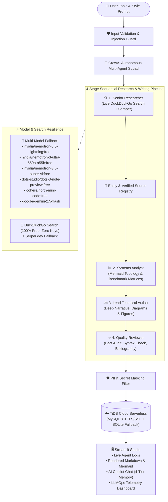

# 🤖 Enterprise Multi-Agent AI Research & Visual Blog Studio

> **Autonomous multi-agent research squad that conducts exhaustive deep research, writes publication-ready technical blog posts with native Mermaid architecture diagrams, curated visuals, and formal citations — powered by CrewAI, OpenRouter Free Fallback LLMs, and TiDB Cloud Serverless.**

[](https://python.org)
[](https://crewai.com)
[](https://openrouter.ai)
[](https://ai.google.dev)
[](https://tidbcloud.com)
[](https://fastapi.tiangolo.com)
[](https://nextjs.org)
[](https://smith.langchain.com)
[](https://owasp.org/www-project-top-10-for-large-language-model-applications/)
[](https://pytest.org)
[](LICENSE)

---

## ✨ What It Does

Give the squad a topic — it autonomously conducts **deep, exhaustive technical investigation** and outputs an **authoritative, publication-grade blog post (2,000–3,500 words)** with zero manual copying, pasting, or prompting.

Unlike typical shallow AI generators, this system:
1. **Drills into minute technical details**: low-level memory/latency trade-offs, internal algorithms, protocol specifications, and production failure modes.
2. **Generates native self-created visuals**: embeds clean **Mermaid.js** flowcharts, sequence diagrams, and state machines directly in the markdown.
3. **Cites verified sources**: includes a complete **References & Further Reading** section linking primary research papers, official docs, and benchmarks.
4. **Resilient against rate limits**: automatically switches between **5 free OpenRouter models** if one fails or hits rate limits (`429`).
5. **Persists memory across sessions**: stores articles, research caches, chat rolling summaries, and user style preferences in **TiDB Cloud Serverless** (with local SQLite fallback).

---

## 🏗️ System Architecture & Workflow



---

## 🎯 Key Capabilities

### 1. 🔍 Exhaustive Deep Research & Low-Level Mechanics
- Investigates primary whitepapers, engineering blogs, and benchmark datasets.
- Catalogs exact metrics (latency, memory footprint, tokens/sec, throughput).
- Pinpoints architectural trade-offs, edge cases, and production failure modes.

### 2. 📊 Native Mermaid.js Diagrams & Curated Visuals
- Generates valid Mermaid diagrams (`flowchart TD`, `sequenceDiagram`, `stateDiagram-v2`) embedded directly in Markdown for GitHub and modern web renderers.
- Features high-resolution figure callouts (``) accompanied by comprehensive explanatory captions.

### 3. 🔄 Multi-Model OpenRouter Auto-Fallback
- Configured with a priority sequence of **5 top-performing free models**:
  1. `nvidia/nemotron-3.5-lightning:free`
  2. `nvidia/nemotron-3-ultra-550b-a55b:free`
  3. `nvidia/nemotron-3.5-super-vl:free`
  4. `dots-studio/dots-3-note-preview:free`
  5. `cohere/north-mini-code:free`
  *(plus `google/gemini-2.5-flash`)*
- Transparently fails over upon `429 Too Many Requests`, timeout, or service unavailability without throwing errors to the user.

### 4. 🦆 100% Free Search with DuckDuckGo
- Uses `ddgs` / `duckduckgo-search` natively for live web searches.
- Requires **zero API keys** and has **no monthly credit caps**.
- Supports Serper.dev as an optional secondary fallback.

### 5. ☁️ TiDB Cloud Serverless (Distributed SQL)
- MySQL 8.0 wire-compatible distributed cloud database with TLS/SSL encryption.
- Multi-region support (e.g. Tokyo `ap-northeast-1` on AWS).
- **Zero-Downtime Offline Fallback**: Automatically connects to local SQLite (`research_studio.db`) with WAL mode if cloud credentials are not supplied.

### 6. 🧠 4-Tier Context & Memory Management
- **Tier 1 (Working Memory)**: Per-task scratchpad isolating intermediate reasoning.
- **Tier 2 (Short-Term Memory)**: Token-budgeted sliding window (last 6 turns) + incremental rolling summary persisted in `chat_sessions`. Selective article injection saves 70–80% of tokens on follow-up questions.
- **Tier 3 (Long-Term Memory)**: Persistent author style, custom tone, and banned jargon stored in `user_memory`.
- **Tier 4 (Entity & Citation Memory)**: Pinned immutable JSON/Markdown registry from research tasks to eliminate citation hallucinations.
- **Research Cache**: Web scrapes cached by SHA-256 hash in `research_cache` to eliminate redundant network fetches.

### 8. ⚡ Hybrid Two-Tier Caching Architecture (L1 RAM + L2 TiDB)
- **Zero Third-Party Infra**: Bypasses the operational overhead and failure points of Redis by pairing in-process Python memory with TiDB Cloud Serverless.
- **L1 In-Memory Fast Cache**: Thread-safe LRU with byte ceiling (~25 MB) and 500-item cap answering hot lookups in **< 0.1ms**.
- **L2 Durable TiDB/SQLite Cache**: Dialect-aware `system_cache` table partitioned by namespace (`web_scrape`, `llm_eval`) with indexed `expires_at` and TLS/SSL encryption.
- **Deterministic LLM Memoization**: Caches deterministic evaluations and reviews (temperature $\le$ 0.2) for 7 days, conserving OpenRouter/Gemini token quotas.
- **Anti-Stampede Locks**: Granular per-key thread mutexes ensure multiple concurrent agent workers never issue duplicate fetches for the same external URL.
- **Fail-Open & Stale-on-Error**: The application never crashes if database or upstream connectivity degrades; automatically serves stale cache data with failover flags.

### 7. 🛡️ Enterprise LLMOps & AI Security Governance
- **OWASP LLM Top 10 Protection**:
  - LLM01: Prompt injection defense with boundary markers.
  - LLM06: Sensitive PII, OpenAI/AWS/GitHub API key masking.
  - LLM08: Anti-SSRF URL filtering blocking loopback, internal IPs, and AWS/GCP cloud metadata services (`169.254.x.x`).
  - LLM09: Indirect prompt injection sanitization on scraped HTML/markdown.
- **Telemetry & Readability Tracking**:
  - Flesch Reading Ease & Flesch-Kincaid Grade Level scoring.
  - Latency, token estimation, and model failover event auditing.
  - Interactive Streamlit Dashboard (**Tab 3: 🛡️ LLMOps & Security Governance**).

---

## 📁 Repository Structure

```
research-and-blog-writer/
├── backend/                 # FastAPI Production Backend
│   ├── main.py              # App entrypoint, CORS, CSRF Origin Guard, Lifespan DB
│   ├── deps.py              # User dependency injection, token extraction priority
│   ├── schemas.py           # Pydantic request/response schemas
│   └── routes/              # Modular API routers
│       ├── auth.py          # Passwordless Email OTP & HttpOnly cookie session
│       ├── research.py      # Resumable SSE run stream & durable execution jobs
│       ├── articles.py      # User-scoped article CRUD
│       ├── revisions.py     # Article revision history & unified diffs
│       └── telemetry.py     # Studio metrics, cache telemetry, and pruning
├── frontend/                # Next.js 15 App Router Frontend
│   ├── app/page.tsx         # Modern SaaS Studio workspace layout
│   ├── components/          # Interactive React components
│   │   ├── auth-dialog.tsx  # Passwordless Email OTP modal
│   │   ├── live-stepper.tsx # 4-Stage visual execution stepper & terminal logs
│   │   ├── mermaid-canvas.tsx# Native Mermaid.js with SVG Pan/Zoom & Fullscreen
│   │   ├── article-viewer.tsx# Sanitized Markdown reader & sticky floating TOC
│   │   ├── copilot-drawer.tsx# Revisions inspector & AI Editorial Copilot
│   │   └── diff-viewer.tsx  # Visual addition/deletion diff comparison
│   ├── lib/api.ts           # Typed API client with credentials include
│   ├── lib/sse.ts           # Resumable SSE with Last-Event-ID reconnection
│   └── next.config.ts       # Reverse proxy (/api -> backend) for same-origin cookies
├── agents/                  # Declarative agent specifications (.jsonc)
│   ├── research.jsonc       # Senior Researcher
│   ├── content_analyst.jsonc# Systems Analyst
│   ├── report_writer.jsonc  # Lead Technical Author
│   └── quality_reviewer.jsonc# Quality Auditor
├── memory/                  # 4-Tier Memory & Context Management
│   ├── __init__.py
│   └── chat_memory.py       # Sliding window, rolling summaries, selective context
├── security/                # OWASP LLM Top 10 Guardrails
│   ├── __init__.py
│   └── guardrails.py        # Injection defense, PII masking, citation validation
├── llmops/                  # LLMOps & Observability
│   ├── __init__.py
│   └── telemetry.py         # TelemetryTracker, Flesch scores, token metrics
├── tools/                   # CrewAI Agent Tools
│   ├── __init__.py
│   ├── search_tool.py       # DuckDuckGo (Free) + Serper fallback
│   ├── scrape_tool.py       # SSRF-guarded scraper with research caching & compaction
│   └── file_tool.py         # Markdown output writer
├── cache/                   # Hybrid Two-Tier Cache
│   ├── __init__.py
│   └── manager.py           # Thread-safe L1 memory LRU + L2 database cache
├── tests/                   # 101 Automated PyTest Suite
│   ├── test_api_auth.py     # FastAPI auth, cookies, articles, and telemetry tests
│   ├── test_api_runs.py     # SSE events, Last-Event-ID resumption, concurrency guard
│   ├── test_backend_purity.py# AST static scan & import purity gate
│   ├── test_cache.py        # Hybrid caching concurrency, eviction, anti-stampede
│   ├── test_red_team.py     # 10-fixture OWASP red team adversarial pack
│   └── ...
│   ├── test_llmops.py       # Telemetry & readability metrics
│   ├── test_memory.py       # Cache, user memory, sliding window
│   ├── test_security.py     # Injection defense, SSRF, PII masking
│   └── test_tools.py        # Search and scrape operations
├── app.py                   # Streamlit Studio (Tabs: Generation, Copilot, LLMOps)
├── crew.py                  # Code-first CrewAI pipeline with task context wiring
├── database.py              # TiDB Cloud Serverless (SSL) + SQLite fallback
├── llm_fallback.py          # FallbackLLM implementation
├── pyproject.toml           # Project dependencies & build configuration
├── requirements.txt         # Standard pip dependency manifest
├── .env.example             # Environment variable template
└── report.md                # Output report (generated on run)
```

---

## 🚀 Quick Start Guide

### 1. Prerequisites
- **Python 3.10 to 3.13**
- **[uv](https://docs.astral.sh/uv/)** (recommended) or `pip`
- An API Key from **[OpenRouter](https://openrouter.ai/keys)** (free) or **[Google Gemini](https://aistudio.google.com/apikey)**

### 2. Clone & Install
```bash
git clone https://github.com/Arjit005/research-and-blog-writer.git
cd research-and-blog-writer

# Using uv (fastest):
uv sync

# Or using pip & virtual environment:
python -m venv .venv
source .venv/bin/activate   # On Windows: .venv\Scripts\activate
pip install -r requirements.txt
```

### 3. Configure Environment Variables
Copy the template:
```bash
cp .env.example .env
```

Edit `.env`:
```ini
# OpenRouter Free Tier Fallback (Recommended)
OPENROUTER_API_KEY=your_openrouter_api_key_here

# Or Google Gemini Direct Key
GEMINI_API_KEY=your_gemini_api_key_here

# TiDB Cloud Configuration (Optional - falls back to SQLite if omitted)
TIDB_HOST=gateway01.ap-northeast-1.prod.aws.tidbcloud.com
TIDB_PORT=4000
TIDB_USER=your_prefix.root
TIDB_PASSWORD=your_cluster_password
TIDB_DATABASE=research_studio
```

---

## 🔐 Secure Email OTP Authentication & Data Isolation

The studio incorporates passwordless authentication using single-use 6-digit verification codes (OTP) dispatched via SMTP, paired with HMAC-SHA256 hashed session tokens.

### Key Security Properties
- **Zero Plaintext Storage**: OTP codes are stored as HMAC-SHA256(OTP_PEPPER, email:code) and session tokens as HMAC-SHA256(SESSION_SECRET, token).
- **Anti-Enumeration Defense**: The server returns an identical message regardless of whether an email exists or is blocked by domain policies.
- **Brute-Force & Race-Condition Lockout**: Attempts are incremented *before* constant-time hash verification. Codes are locked after 5 failed attempts.
- **Rate-Limiting & Cooldown**: Mandatory 60-second cooldown per email, 5 requests per email per hour, and 20 per IP per hour.
- **Multi-Tenant Isolation**: Every SQL query filters strictly by WHERE user_id = ?. Cross-tenant ID guessing fails closed.
- **Explicit Legacy Claiming**: Pre-existing articles created before authentication can be claimed once by verified users via a dedicated sidebar button.

### How to Configure SMTP Credentials
1. **Gmail SMTP (Recommended for Personal Dev)**:
   - Enable **2-Step Verification** on your Google Account (myaccount.google.com/security).
   - Navigate to **App Passwords** (myaccount.google.com/apppasswords).
   - Create a new password named AI Research Studio (generates a 16-character string).
   - In .env:
     `env
     SMTP_HOST=smtp.gmail.com
     SMTP_PORT=587
     SMTP_USER=your_email@gmail.com
     SMTP_PASSWORD=xxxx xxxx xxxx xxxx
     SMTP_FROM=AI Research Studio <your_email@gmail.com>
     SMTP_USE_TLS=true
     `
2. **Transactional Email Services (Brevo, Resend, SendGrid)**:
   - Create an account on [Resend](https://resend.com) or [Brevo](https://www.brevo.com).
   - Generate an SMTP API Key and configure SMTP_HOST, SMTP_PORT, and SMTP_PASSWORD accordingly.

### Local Development Mode (AUTH_DEV_MODE=true)
When AUTH_DEV_MODE=true is set in .env:
- External SMTP delivery is bypassed.
- Verification codes are displayed directly inside the Streamlit UI with a yellow badge.
- Automatically refuses to run if production database markers (TIDB_HOST) are configured, preventing accidental activation in production.

---

## ⚙️ Environment Variables Reference

| Variable Name | Purpose | Required / Default |
|---|---|---|
| OTP_PEPPER | Secret string mixed into OTP HMAC-SHA256 hashes | **Required** (Auto-fallback in dev mode) |
| SESSION_SECRET | Secret string mixed into session token hashes | **Required** (Auto-fallback in dev mode) |
| SMTP_HOST | Hostname of SMTP email server | Optional in Dev Mode, Required for real delivery |
| SMTP_PORT | Port for SMTP service | Default: 587 |
| SMTP_USER | SMTP username / account email | Optional in Dev Mode |
| SMTP_PASSWORD | SMTP password or app password | Optional in Dev Mode |
| SMTP_FROM | Display sender address | Default: 
oreply@research-studio.local |
| SMTP_USE_TLS | Enforce STARTTLS encryption | Default: 	rue |
| OTP_TTL_SECONDS | Lifetime of a 6-digit code in seconds | Default: 300 (5 minutes) |
| OTP_MAX_ATTEMPTS | Maximum allowed invalid attempts before lockout | Default: 5 |
| OTP_RESEND_COOLDOWN_SECONDS | Wait time required before re-sending code | Default: 60 |
| OTP_MAX_PER_EMAIL_PER_HOUR | Maximum OTP requests per email in 60 min | Default: 5 |
| OTP_MAX_PER_IP_PER_HOUR | Maximum OTP requests per IP in 60 min | Default: 20 |
| SESSION_TTL_HOURS | Lifetime of an authenticated session | Default: 168 (7 days) |
| ALLOWED_EMAIL_DOMAINS | Restrict access to comma-separated domains | Default: Empty (All allowed) |
| AUTH_DEV_MODE | Display codes on screen and bypass SMTP | Default: alse |
| OPENROUTER_API_KEY | Access to 5 free multi-model fallback LLMs | Recommended |
| TIDB_HOST | TiDB Cloud Serverless host address | Optional (falls back to SQLite) |
| TIDB_USER | TiDB Cloud SQL username | Optional |
| TIDB_PASSWORD | TiDB Cloud SQL password | Optional |

---

## ☁️ Connecting TiDB Cloud Serverless

This project supports **TiDB Cloud Serverless** on AWS / GCP:

1. Log into your [TiDB Cloud Console](https://tidbcloud.com/).
2. Under **My TiDB**, click on **Resource View** (or expand your project folder, e.g. `research_and_blog`) to locate your instance (e.g. `research-and-blog-db`).
3. If the status says **Creating**, wait ~30-60 seconds until it turns green (**Available**).
4. Click **Connect** in the top-right corner of the cluster dashboard:
   - Connection Type: **General**
   - Tool/Language: **PyMySQL** (or standard MySQL client)
   - Generate or set a secure password for your user (e.g. `<prefix>.root`).
5. Copy your connection parameters into `.env`:
   ```ini
   TIDB_HOST=gateway01.ap-northeast-1.prod.aws.tidbcloud.com
   TIDB_PORT=4000
   TIDB_USER=your_prefix.root
   TIDB_PASSWORD=your_cluster_password
   TIDB_DATABASE=research_studio
   ```
6. **Automatic Reconnection & SSL**:
   - The studio connects over TLS/SSL with pre-ping validation (`pool_pre_ping=True`).
   - If a connection dropped due to serverless idle sleep, it transparently reconnects on the first retry.
   - The Studio UI displays an honest real-time status pill (**TiDB Cloud Live** vs **Local SQLite Fallback**) and allows one-click database re-testing.

---

## 🖥️ Running the Application

### Option A: Modern SaaS Studio (Next.js 15 + FastAPI Streaming Backend) — Recommended

**Terminal 1 — FastAPI Backend:**
```bash
uv run uvicorn backend.main:app --reload --port 8000
```

**Terminal 2 — Next.js 15 Frontend:**
```bash
cd frontend
npm run dev
```
Open **[http://localhost:3000](http://localhost:3000)** in your browser:
- **Commission AI Squad**: Type custom research topics or choose curated presets.
- **Durable Live Stepper**: 4-agent visual progress pipeline with real-time terminal activity, token tracker, and cancellation.
- **Native Mermaid Canvas**: Interactive client-rendered diagrams with SVG Pan/Zoom, Fullscreen mode, and SVG export.
- **Sanitized Markdown Reader**: Sticky floating Table of Contents, word count, and export options.
- **AI Editorial Copilot**: Slide-over drawer with unified revision diffs and rollback restore.

### Option B: Classic Web Studio (Streamlit Fallback)
```bash
uv run streamlit run app.py
```
Open [http://localhost:8501](http://localhost:8501) in your browser.

### Option C: Run via CLI
```bash
# Interactive topic prompt:
uv run python crew.py

# Or pass topic directly:
uv run python crew.py --topic "LLMOps in 2026: Architectures, Guardrails, and Observability"
```

---

## 🧪 Automated Test Suite & Red-Team Attack Pack

The project includes an enterprise-grade automated test suite featuring **101 passing unit, integration, red-team, cache, and API tests**:

```bash
# Run all tests
uv run pytest -q

# Run red-team adversarial injection & SSRF pack only
uv run pytest tests/test_red_team.py -v
```

### 10-Fixture Red-Team Attack Pack (`tests/test_red_team.py`)
1. **Hidden CSS Prompt Injection**: Strips obfuscated instructions hidden via `display:none`, `visibility:hidden`, `opacity:0`, and zero-point fonts.
2. **Adversarial Comment Injections**: Identifies and drops prompt overrides embedded in HTML comments `<!-- [System Note: ...] -->`.
3. **Delimiter / Fence Escapes**: Defeats closing delimiter breakout attempts (`</untrusted_source>`).
4. **SSRF Redirect Hops**: Blocks redirect chains attempting to pivot from allowed public URLs into `127.0.0.1` or internal networks.
5. **Cloud Metadata Trapping**: Completely rejects AWS/GCP/Azure link-local metadata queries (`http://169.254.169.254/`).
6. **Huge Webpage DoS Defense**: Enforces streaming abort when response bodies exceed 2 MB.
7. **PII & Credential Redaction**: Automatically sanitizes emails, phone numbers, credit card sequences, and API keys.
8. **Hallucinated Citation Verification**: Uses `CitationGuard` to flag unvisited URLs and enforce the strict **"Diagrams Only (Mermaid)"** visual policy.
9. **Resilient Mermaid Syntax Handling**: Extracts and sandboxes diagram segments, gracefully displaying code blocks if rendering fails.
10. **Multi-Tenant Memory Poisoning**: Enforces 500-char per-preference caps (2,000 chars total) and isolates memory inside `<user_preferences>` non-executable XML delimiters.

---

## 🚢 Cloud Deployment (Render & Streamlit Cloud)

### Deploying on Render (FastAPI + Next.js 15):
1. Link your GitHub repository in [Render Dashboard](https://dashboard.render.com/).
2. Select **Web Service**, runtime: **Python 3**.
3. Set **Build Command**:
   ```bash
   pip install -r requirements.txt && cd frontend && npm install && npm run build
   ```
4. Set **Start Command**:
   ```bash
   uvicorn backend.main:app --host 0.0.0.0 --port $PORT
   ```
5. Add your Environment Variables:
   - `OPENROUTER_API_KEY`: Your OpenRouter API key
   - `TIDB_HOST`: e.g. `gateway01.ap-northeast-1.prod.aws.tidbcloud.com`
   - `TIDB_PORT`: `4000`
   - `TIDB_USER`: TiDB user
   - `TIDB_PASSWORD`: TiDB password
   - `TIDB_DATABASE`: `research_studio` (or `test`)
   - `OTP_PEPPER`: 32-byte hex secret for HMAC hashing
   - `SESSION_SECRET`: 32-byte hex secret for cookie signing
   - `AUTH_DEV_MODE`: `false` (or `true` if bypassing SMTP in staging)
   - `LANGSMITH_API_KEY`: Your LangSmith API key for end-to-end tracing
   - `LANGSMITH_TRACING`: `true`
   - `LANGSMITH_PROJECT`: `research-and-blog-writer`

---

## 📄 License
This project is licensed under the [MIT License](LICENSE).
