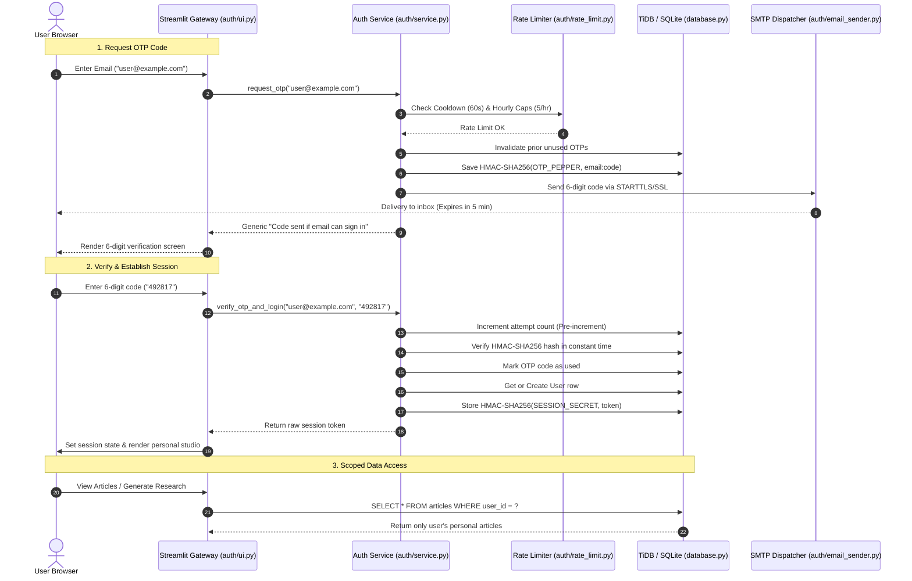

# Secure Email OTP Authentication & Per-User Isolation

## Architectural Overview

The AI Research Studio implements passwordless authentication using single-use 6-digit verification codes (OTP) dispatched via SMTP, paired with cryptographically signed and hashed session tokens.

All user articles, revisions, Copilot chat sessions, author preferences (long-term memory), and telemetry traces are scoped to the authenticated `user_id`, guaranteeing multi-tenant isolation across TiDB Cloud Serverless and local SQLite.

## Security Guarantees & Defenses

1. **Anti-Enumeration Defense**: The server returns an identical timing-similar response whether the email exists, is brand new, or belongs to a restricted domain.
2. **Zero Plaintext Storage**:
   - OTP codes are hashed via `HMAC-SHA256(OTP_PEPPER, email + ":" + code)`.
   - Session tokens are hashed via `HMAC-SHA256(SESSION_SECRET, raw_token)`.
   - A database compromise never exposes usable plain OTP codes or session tokens.
3. **Brute-Force & Race-Condition Defense**: Attempt counters are incremented *before* hash comparison. After 5 incorrect attempts, the code is irrevocably invalidated.
4. **Resend Cooldown & Send Caps**: A mandatory 60-second cooldown per email, 5 requests per email per hour, and 20 requests per IP per hour prevent email bombing.
5. **No Phishing Vectors**: Authentication emails contain zero clickable links—only the 6-digit numeric token.
6. **Multi-Tenant Isolation**: Every SQL query (`SELECT`, `INSERT`, `UPDATE`, `DELETE`) enforces `WHERE user_id = ?`. Cross-tenant ID guessing fails closed.
